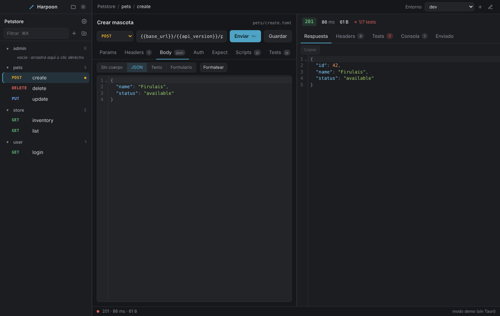

# Harpoon

Cliente de APIs **100 % offline**, escrito en Rust. Un arpón que lanzas a un endpoint.

Las colecciones viven como archivos TOML junto a tu código y se versionan con Git.
La misma colección sirve para el trabajo manual (app de escritorio), la terminal y CI/CD.
Sin cuenta, sin nube, sin telemetría, sin descargas en tiempo de ejecución.



## Principios

1. **Offline por diseño.** El binario nunca abre conexiones que no hayas pedido tú
   ([ADR-001](docs/adr/001-offline.md)).
2. **Texto plano y Git.** Todo lo que define una colección es un archivo legible y
   diffeable ([formato](docs/format.md)). Los secretos nunca entran en el repo.
3. **Un binario.** Sin runtimes externos: el motor de scripts (QuickJS), el generador
   de docs y el servidor mock van embebidos.
4. **CLI primero.** Todo lo que hace la app lo puede hacer `harpoon` desde la terminal.

## Qué hace hoy

| Área | Estado |
|---|---|
| Colecciones en TOML, carpetas anidadas, entornos, secretos fuera de Git | ✅ |
| REST: todos los métodos, cabeceras, query, JSON/texto/formulario | ✅ |
| Auth: Basic, Bearer, API key, Digest, OAuth2 (3 flujos, caché de tokens) | ✅ |
| TLS: rustls, CA propia, certificado de cliente (mTLS), proxy, timeouts | ✅ |
| Variables `{{var}}` por ámbitos + dinámicas (`$uuid`, `$timestamp`, `$randomInt`…) | ✅ |
| Aserciones declarativas `[expect]` | ✅ |
| Scripts JS `pre`/`post`/`test` con `expect` estilo Chai, sin Node | ✅ |
| Variables de ejecución persistentes (login → token → resto) | ✅ |
| CLI: `init`, `list`, `send`, `run` con `--json`, `--junit`, `--data`, `--iterations`, `--bail` | ✅ |
| App de escritorio (Tauri 2 + Svelte 5): árbol con arrastrar y soltar, editor, respuesta, tests, consola, vista HTML, entornos y ajustes | ✅ |
| GraphQL, WebSocket, gRPC | ⏳ fase 5 |
| OpenAPI import/export, docs HTML, servidor mock | ⏳ fase 6 |
| Distribución (`.dmg`, Homebrew, winget) | ⏸ pospuesta |

## Instalación

Requisitos: Rust estable (1.85+). Para la app de escritorio, además Node 20+ y en
macOS las Xcode Command Line Tools (`xcode-select --install`).

```sh
# CLI
cargo install --path crates/harpoon-cli

# App de escritorio (desarrollo)
cd apps/desktop
npm install
npm run tauri dev          # ventana con recarga en caliente
npm run tauri build        # .app / .dmg en src-tauri/target/release/bundle
```

## Uso rápido

```sh
harpoon init mi-api            # crea harpoon.toml, environments/dev.toml, requests/health.toml
cd mi-api
harpoon list                   # solicitudes con las URLs resueltas
harpoon send health -v         # envía y muestra petición + respuesta (credenciales ocultas)
harpoon run                    # ejecuta toda la colección: [expect] + tests de scripts
harpoon run users --env prod   # solo la carpeta users/, con otro entorno
harpoon run --junit out.xml    # informe JUnit para GitHub Actions / GitLab
harpoon run --data casos.csv   # una ejecución por fila; --iterations N para repetir
harpoon run --bail --json      # para CI: se detiene al primer fallo, informe JSON
```

Códigos de salida: `0` todo correcto, `1` alguna comprobación falló, `2` error de uso o de red.

### Una solicitud

`requests/users/create.toml`:

```toml
name = "Crear usuario"
method = "POST"
url = "{{base_url}}/users"

[headers]
Content-Type = "application/json"

[body]
type = "json"
json = '{ "name": "Ada" }'

[expect]
status = 201
max_time_ms = 500

[scripts]
post = 'harpoon.vars.set("user_id", harpoon.res.json().id);'
test = 'test("tiene id", () => expect(harpoon.res.json()).to.have.property("id"));'
```

### Login y token en dos líneas

```toml
# requests/auth/login.toml
[scripts]
post = 'harpoon.vars.set("token", harpoon.res.json().token);'

# harpoon.toml
[auth]
type = "bearer"
token = "{{token}}"
```

Tras `login`, todas las solicitudes con auth heredada envían `Authorization: Bearer …`.
Las variables de ejecución se guardan en `.harpoon/vars.toml` (fuera de Git).

## App de escritorio

- Árbol de carpetas y solicitudes con **arrastrar y soltar**, menú contextual, filtro
  (`⌘K`) y navegación por teclado (flechas, `Enter`, `F2`, `⌘⌫`).
- Pestañas Params / Headers / Body / Auth / Expect / Scripts / Tests / Docs.
- Respuesta con JSON plegable y búsqueda (`⌘F`), cabeceras, cookies, tests (Expect +
  scripts), consola de `console.log`, vista previa HTML en iframe aislado, imágenes,
  lo que se envió realmente e historial de las últimas 50 respuestas.
- Entornos con variables secretas (van a `*.secrets.toml`), ajustes de colección
  (auth global, variables, scripts, TLS, proxy).
- Atajos: `⌘↩` enviar, `⌘S` guardar, `⌘N` nueva solicitud, `⇧⌘N` carpeta, `⌘E`
  entornos, `⌘,` ajustes.
- Modo demo sin Rust: `npm run dev` abre la UI en el navegador con datos de ejemplo.

## Documentación

| Documento | Contenido |
|---|---|
| [docs/format.md](docs/format.md) | Formato de colección: `harpoon.toml`, entornos, solicitudes, variables |
| [docs/scripting.md](docs/scripting.md) | API de scripts (`harpoon.req/res/vars`), `test`, `expect`, orden de ejecución |
| [docs/auth.md](docs/auth.md) | Basic, Bearer, API key, Digest, OAuth2, mTLS, uso en CI |
| [docs/adr/001-offline.md](docs/adr/001-offline.md) | Por qué y cómo Harpoon es 100 % offline |
| [ROADMAP.md](ROADMAP.md) | Plan detallado por fases |

## Roadmap

| Fase | Contenido | Estado |
|---|---|---|
| 0 | Base: workspace, CI, formato TOML, motor de variables, `init`/`list` | ✅ |
| 1 | Núcleo: herencia por carpeta (`folder.toml`), tipos de variable, llavero del SO, `validate`, escritura preservando comentarios | 🔶 parcial (variables dinámicas y secretos hechos) |
| 2 | REST + CLI para CI: auth completa, TLS/mTLS, `send`/`run`, JUnit, datos, iteraciones | ✅ |
| 3 | Scripts y tests: QuickJS embebido, `pre`/`post`/`test`, `expect` estilo Chai, variables persistentes | ✅ |
| 4 | Escritorio: Tauri 2 + Svelte 5, gestión completa de la colección, DnD, accesibilidad | ✅ (en mejora continua) |
| 4b | Calidad de vida: historial de respuestas, búsqueda en la respuesta, cookies, imágenes/binarios | ✅ (falta diff) |
| 5 | Protocolos: GraphQL (introspección y esquemas locales), WebSocket, gRPC (`.proto` y reflexión) | ⏳ |
| 6 | Ciclo de vida: import/export OpenAPI (y Postman/Bruno/`.http`), `harpoon docs` HTML autocontenido, `harpoon mock` | ⏳ |
| 7 | Editor: extensión de VS Code que invoca la CLI | ⏳ |
| — | Distribución: `.dmg` firmado desde CI, Homebrew, winget, AppImage | ⏸ pospuesta |

**No objetivos:** sincronización en la nube, cuentas de usuario, telemetría, IA contra
proveedores externos, funciones "enterprise" (SSO, SCIM, licencias), reimplementar Git.

## Estructura del repositorio

```
crates/
  harpoon-core/    modelo de datos, formato en disco, variables, operaciones de colección
  harpoon-http/    ejecución REST: auth (incl. OAuth2/Digest), TLS, aserciones [expect]
  harpoon-script/  motor JS embebido (QuickJS), tests y pipeline de ejecución
  harpoon-cli/     binario `harpoon`
apps/
  desktop/         app de escritorio: src-tauri (Rust) + src (Svelte 5 + CodeMirror)
docs/              formato, scripting, auth, ADRs
examples/petstore/ colección de ejemplo
```

## Desarrollo

```sh
cargo test --workspace
cargo clippy --workspace --all-targets -- -D warnings
cargo fmt --check
cd apps/desktop && npm run check && npm run build
```

El CI (GitHub Actions) ejecuta todo lo anterior en Linux, macOS y Windows.

## Licencia

MIT.
